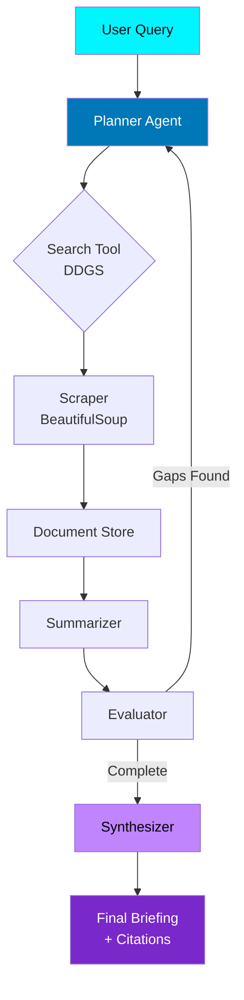

<p align="center">
  
  
  
  
  
  
  
</p>

<p align="center">
  
  
  
  
</p>

<h1 align="center">⚡ Autonomous Research Agent</h1>

<p align="center">
  <strong>A production-grade, multi-provider AI research agent with neural planning, live web crawling, and synthesized citations — wrapped in a cyberpunk-themed real-time Streamlit interface.</strong>
</p>

<p align="center">
  <a href="#-features">Features</a> •
  <a href="#-architecture">Architecture</a> •
  <a href="#-quick-start">Quick Start</a> •
  <a href="#-configuration">Configuration</a> •
  <a href="#-providers">Providers</a> •
  <a href="#-api-reference">API Reference</a> •
  <a href="#-project-structure">Structure</a> •
  <a href="#-roadmap">Roadmap</a>
</p>

---

## 🌟 Features

| Category | Capabilities |
|----------|--------------|
| **🧠 Neural Planning** | LLM-driven query decomposition → 2-3 strategic searches per cycle |
| **🌐 Live Web Crawling** | DuckDuckGo (no API key) + BeautifulSoup extraction with noise filtering |
| **📝 Iterative Summarization** | Context-aware synthesis with inline citations `[Source: Title/URL]` |
| **⚖️ Completeness Evaluation** | Self-critique loop: detects gaps → triggers additional research cycles |
| **📊 Real-Time HUD** | Cyberpunk Heads-Up Display with step timeline + streaming terminal logs |
| **🎨 4 Neon Themes** | Cyber Cyan, Synthwave Violet, Matrix Emerald, Solar Amber — full CSS-in-JS |
| **🔄 Multi-Provider** | Groq (free), OpenAI, Google Gemini, Ollama (local) — hot-swappable |
| **💾 Export & History** | Download `.md` reports + `.json` pipeline state; session history with recall |
| **🔬 RAG-Ready** | FAISS vector store + sentence-transformers embeddings (lazy-loaded) |

---

## 🏗 Architecture



### Pipeline Stages

```python
# Core orchestration loop (research_agent.py:447-474)
def run(self, question: str, max_iterations: int = 3, callback=None) -> ResearchState:
    state = self.plan_search(initial_state, callback)      # 🎯 LLM generates 2-3 queries
    state = self.scrape_sources(state, callback)           # 🌐 Extract content from top results
    state = self.summarize_documents(state, callback)      # 📝 Synthesize findings
    
    while state.needs_more_search and state.iteration < state.max_iterations:
        state = self.evaluate_completeness(state, callback) # ⚖️ Self-critique
        if state.needs_more_search:
            state = self.plan_search(state, callback)       # 🔄 Gap-filling iteration
            state = self.scrape_sources(state, callback)
            state = self.summarize_documents(state, callback)
    
    state = self.generate_final_answer(state, callback)     # 🚀 Authoritative briefing
    return state
```

---

## 🚀 Quick Start

### Prerequisites
- Python **3.10+**
- `pip` / `uv` / `poetry`
- (Optional) Ollama for local models

### Installation

```bash
# 1. Clone repository
git clone https://github.com/mavericknihar/Ai_Research_Agent.git
cd Ai_Research_Agent/research_agent

# 2. Create virtual environment (recommended)
python -m venv .venv
source .venv/bin/activate  # Windows: .venv\Scripts\activate

# 3. Install dependencies
pip install -r requirements.txt

# 4. Configure environment
cp .env.example .env
# Edit .env with your API keys (see Configuration below)

# 5. Launch
streamlit run app.py
```

### One-Command Demo (Groq Free Tier)

```bash
# Get free key at https://console.groq.com (14,400 req/day)
export GROQ_API_KEY="your-key-here"
streamlit run app.py
```

---

## ⚙️ Configuration

### Environment Variables (`.env`)

```bash
# ============================================
# LLM PROVIDERS (choose ONE)
# ============================================

# GROQ - FREE, ⚡ Instant (Recommended for demo)
# Free tier: 14,400 requests/day | 6,000 RPM
# Models: openai/gpt-oss-20b, openai/gpt-oss-120b, qwen/qwen3.8-27b
GROQ_API_KEY=gsk_xxxxxxxxxxxxxxxxxxxxxxxx

# OPENAI - Production Grade
# Models: gpt-4o-mini, gpt-4o, o3-mini
OPENAI_API_KEY=sk-xxxxxxxxxxxxxxxxxxxxxxxx

# GOOGLE GEMINI - Free Tier Available
# Models: gemini-1.5-flash, gemini-1.5-pro
GOOGLE_API_KEY=xxxxxxxxxxxxxxxxxxxxxxxx

# OLLAMA - 100% Local & Private
# No API key needed. Run: ollama pull llama3.1 && ollama serve
OLLAMA_BASE_URL=http://localhost:11434

# ============================================
# OPTIONAL
# ============================================
DEFAULT_PROVIDER=groq
HF_TOKEN=hf_xxxxxxxxxxxxxxxxxxxxxxxx  # Higher HF Hub rate limits
```

### Research Hyperparameters (UI Sidebar)

| Parameter | Range | Default | Description |
|-----------|-------|---------|-------------|
| **Research Cycles** | 1–4 | 2 | Depth of iterative search loops |
| **Temperature** | 0.0–1.0 | 0.3 | Creativity vs. factual precision |
| **Max Results/Cycle** | Fixed | 5 | DuckDuckGo results per query |
| **Doc Char Limit** | Fixed | 2,500 | Per-source token budget |

---

## 🔌 Providers Comparison

| Provider | Cost | Speed | Context | Best For | Setup |
|----------|------|-------|---------|----------|-------|
| **Groq** | 🆓 Free | ⚡ Instant | 128k | Demos, prototypes, high-volume | API key only |
| **OpenAI** | 💰 Paid | Fast | 128k | Production, highest quality | API key |
| **Gemini** | 🆓 Free tier | Fast | 1M | Long-context, Google ecosystem | API key |
| **Ollama** | 🆓 Local | Varies | Model-dep | Privacy, offline, custom models | `ollama serve` |

### Recommended Models by Provider

```python
DEFAULT_MODELS = {
    "groq": [
        "openai/gpt-oss-20b",      # ⚡ Default: ultra-fast, high TPM
        "openai/gpt-oss-120b",     # 🧠 Deep reasoning, 128k context
        "qwen/qwen3.8-27b",        # 🌐 Multilingual, strong coding
    ],
    "openai": [
        "gpt-4o-mini",             # 💎 Best price/performance
        "gpt-4o",                  # 🏆 Highest quality
        "o3-mini",                 # 🧮 Reasoning-optimized
    ],
    "gemini": [
        "gemini-1.5-flash",        # 🆓 Free tier, 1M context
        "gemini-2.0-flash",        # ⚡ Latest, faster
        "gemini-1.5-pro",          # 💰 Paid, 2M context
    ],
    "ollama": [
        "llama3.1",                # 🦙 Default, balanced
        "llama3.1:70b",            # 🏋️ Heavy reasoning
        "mistral", "qwen2.5", "phi3"
    ],
}
```

---

## 📚 API Reference

### Factory Function

```python
from research_agent import create_agent, LLMProvider

# Simple creation
agent = create_agent(
    provider="groq",           # "groq" | "openai" | "ollama" | "gemini"
    model="openai/gpt-oss-20b", # Optional: auto-selects default if omitted
    api_key="gsk_...",         # Optional: reads from env if omitted
    temperature=0.3,           # Optional: 0.0–1.0
    ollama_base_url="http://localhost:11434"  # Optional: Ollama only
)

# Run research
state = agent.run(
    question="Latest breakthroughs in neuromorphic computing 2026",
    max_iterations=3,
    callback=my_progress_callback  # Optional: real-time updates
)

# Access results
print(state.final_answer)      # Markdown briefing with citations
print(state.sources)           # List[Dict{title, url, snippet}]
print(state.summaries)         # Per-cycle summaries
print(state.iteration)         # Cycles completed
```

### Callback Protocol

```python
def my_callback(event_type: str, message: str, data: dict = None):
    """
    Event types: plan_start, queries_planned, search_query_done,
                 scrape_start, source_scraped, summarize_start,
                 summarize_done, eval_done, synthesize_start,
                 synthesize_done, complete
    """
    print(f"[{event_type.upper()}] {message}")
    if data:
        print(f"  Data: {data}")
```

### Data Classes

```python
@dataclass
class ResearchState:
    question: str
    search_results: List[SearchResult]  # Raw DDGS results
    documents: List[Document]           # Scraped content
    summaries: List[str]                # Per-cycle syntheses
    final_answer: str                   # Final markdown briefing
    sources: List[Dict]                 # Citation metadata
    iteration: int                      # Current cycle
    max_iterations: int                 # Configured depth
    needs_more_search: bool             # Evaluator decision
    error: Optional[str]                # Any pipeline error
```

---

## 📁 Project Structure

```
research_agent/
├── app.py                  # 🎨 Streamlit UI (905 lines)
│   ├── Neon CSS-in-JS theming (4 themes)
│   ├── Real-time HUD with terminal logs
│   ├── Source evidence grid
│   ├── History sidebar with recall
│   └── Export: .md report + .json state
├── research_agent.py       # 🧠 Core agent (512 lines)
│   ├── ResearchAgent class
│   ├── WebSearchTool (DDGS)
│   ├── WebScraper (BeautifulSoup)
│   ├── Summarizer & AnswerSynthesizer
│   ├── LLM factory (4 providers)
│   └── Embeddings factory (HF/OpenAI)
├── requirements.txt        # 17 dependencies
├── .env.example            # Config template
├── .env                    # Your secrets (gitignored)
└── __init__.py             # Package exports
```

---

## 🛠 Tech Stack

| Layer | Technology | Version |
|-------|------------|---------|
| **Frontend** | Streamlit | ≥1.35 |
| **Orchestration** | LangChain + LangGraph | ≥0.2 |
| **LLM Providers** | Groq, OpenAI, Google GenAI, Ollama | Latest |
| **Search** | DDGS (DuckDuckGo) | ≥9.0 |
| **Scraping** | BeautifulSoup4 + lxml | ≥4.12 |
| **Embeddings** | sentence-transformers (all-MiniLM-L6-v2) | ≥3.0 |
| **Vector Store** | FAISS-CPU | ≥1.8 |
| **Env Management** | python-dotenv | ≥1.0 |

---

## 💡 Usage Examples

### Basic Research Query

```python
agent = create_agent(provider="groq")
result = agent.run(
    "Quantum error correction breakthroughs 2026 surface codes",
    max_iterations=3
)
print(result.final_answer)
```

### With Progress Callback (for custom UIs)

```python
def hud_callback(event, msg, data):
    icons = {
        "plan_start": "🎯", "search_query_done": "🌐",
        "scrape_start": "📄", "summarize_done": "📝",
        "eval_done": "⚖️", "synthesize_done": "🚀"
    }
    print(f"{icons.get(event, '⚡')} {msg}")

agent = create_agent(provider="ollama", model="llama3.1")
result = agent.run("RISC-V vector extension adoption", callback=hud_callback)
```

### Export Pipeline State

```python
import json

result = agent.run("Solid-state battery commercial readiness")
export = {
    "question": result.question,
    "answer": result.final_answer,
    "iterations": result.iteration,
    "sources": result.sources,
    "summaries": result.summaries,
    "raw_documents": [
        {"url": d.metadata["url"], "title": d.metadata["title"], "chars": len(d.content)}
        for d in result.documents
    ]
}
with open("research_export.json", "w") as f:
    json.dump(export, f, indent=2)
```

---

## 🎨 UI Showcase

### Neon Themes (Live Switchable)
| Theme | Primary | Accent | Vibe |
|-------|---------|--------|------|
| ⚡ **Cyber Cyan** | `#00f5ff` | `#7928ca` | Classic hacker |
| 🔮 **Synthwave Violet** | `#c084fc` | `#f43f5e` | Retro-futurism |
| 🟢 **Matrix Emerald** | `#00ff9d` | `#00b4d8` | Terminal green |
| 🔥 **Solar Amber** | `#ffb703` | `#e63946` | Warning/system |

### HUD Components
- **Step Timeline**: 6-stage pipeline with live status (◉ RUNNING / ✓ DONE / ○ STANDBY)
- **Streaming Terminal**: Timestamped logs with tags `[PLAN]`, `[SEARCH]`, `[SCRAPE]`, `[ANALYZE]`
- **Source Grid**: Hoverable evidence cards with domain, title, snippet, visit link
- **Briefing Card**: Glassmorphic container with gradient header, markdown rendering

---

## 🗺 Roadmap

- [ ] **LangGraph Native**: Migrate to `StateGraph` for checkpointing & visualization
- [ ] **Parallel Scraping**: `asyncio` + `aiohttp` for concurrent extraction
- [ ] **Reranker**: Cross-encoder reranking before summarization
- [ ] **Multi-Modal**: Image/table extraction from PDFs & web pages
- [ ] **Scheduled Research**: Cron-style automated deep dives
- [ ] **API Server**: FastAPI wrapper for headless deployment
- [ ] **Authentication**: Multi-user sessions with persistence
- [ ] **Telemetry**: LangSmith tracing integration

---

## 🤝 Contributing

```bash
# 1. Fork & clone
git clone https://github.com/yourfork/Ai_Research_Agent.git

# 2. Create feature branch
git checkout -b feat/amazing-feature

# 3. Install dev deps
pip install -r requirements.txt
pip install black ruff pytest

# 4. Format & lint
black . && ruff check .

# 5. Test
pytest tests/ -v

# 6. Submit PR
```

---

## 📄 License

**MIT License** — Educational project for MSc Semester 3.  
See [LICENSE](LICENSE) for details.

---

## 🙏 Acknowledgments

- **Groq** for blazing-fast free inference
- **LangChain** for agent orchestration primitives
- **DDGS** for free web search without API keys
- **Streamlit** for the reactive Python frontend
- **Sentence Transformers** for local embeddings

---

<p align="center">
  <strong>Built with ⚡ for Semester 3 • Autonomous Systems Research</strong><br>
  <sub>Powered by LangChain • Groq High-Speed Inference • Streamlit Neon UI</sub>
</p>

<p align="center">
  <a href="https://github.com/mavericknihar/Ai_Research_Agent/stargazers">
    
  </a>
  <a href="https://github.com/mavericknihar/Ai_Research_Agent/forks">
    
  </a>
  <a href="https://github.com/mavericknihar/Ai_Research_Agent/issues">
    
  </a>
</p>